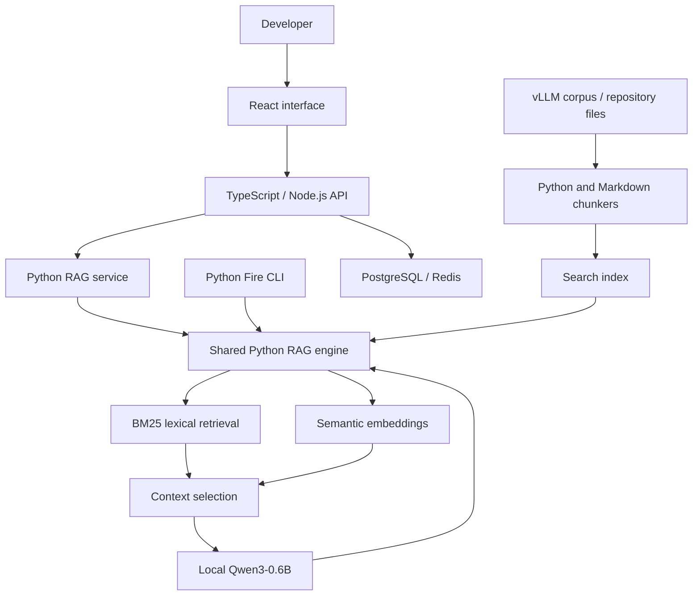

# RAG Scope

**Retrieval-Augmented Generation (RAG) for understanding Git repositories.**

RAG Scope is a codebase intelligence project designed to help developers navigate unfamiliar repositories, find relevant source code, and ask questions grounded in real files rather than an LLM's guesses.

The project begins with **RAG Against the Machine**, an assignment focused on indexing and querying the supplied vLLM codebase. Its planned extension is a full-stack application that lets users explore Git repositories through a TypeScript backend and a Python retrieval and ML service.

## What RAG Scope serves and what problem does it solve ?

Understanding a large software project can take days, especially when its code is spread across multiple repositories.
RAG Scope lets developers ask questions about entire software projects in plain English and get clear answers backed by the actual code.
It saves time, simplifies onboarding, and helps developers understand unfamiliar projects faster.

## Why use RAG Scope instead of ChatGPT, Claude Code, or Codex? 

AI assistants can sometimes give incorrect answers, miss important information, or waste tokens searching through large amounts of code.

**RAG Scope aims to solve this by:**

Searching multiple repositories at once, not just one project.
Reducing AI hallucinations by grounding answers in real code and measuring search accuracy.
Saving tokens and costs by finding only the relevant information instead of processing unnecessary code.
The goal: faster, cheaper, and more reliable answers about complex software projects.

## What RAG Scope aims to do

- **Understand a codebase:** Ask natural-language questions about files, functions, and implementation details.
- **Find the evidence:** Retrieve relevant source locations with precise file paths and character offsets.
- **Explain with context:** Generate answers using a local LLM and retrieved source snippets.
- **Measure quality:** Evaluate retrieval with recall@k instead of relying on convincing-looking responses.
- **Explore repositories through an API:** Eventually expose the RAG engine to a web application and other clients.

### Example questions

> Where does this repository initialize its API server?

> How is request batching implemented?

> Which files fixes the X problem in this repo, and what do they say?

*These are examples of intended usage, not demonstrations of an implemented system.*

## Architecture

RAG Scope is designed as two layers that share one retrieval engine.



### Core pipeline

1. **Index:** Read source files, use distinct strategies for Python and Markdown/text, generate bounded chunks, and persist a searchable index.
2. **Retrieve:** Rank source snippets with BM25 or TF-IDF and return exact source file paths and character offsets.
3. **Augment:** Select relevant snippets within the model's context budget.
4. **Generate:** Ask local **Qwen/Qwen3-0.6B** to produce a source-grounded answer.
5. **Evaluate:** Measure retrieval accuracy using recall@k and track indexing/query performance.

## Technology stack

| Layer | Technology | Purpose |
| --- | --- | --- |
| RAG engine | Python 3.10+, Pydantic | Indexing, retrieval, typed results |
| CLI and tooling | Python Fire, `uv`, tqdm | Required executable interface and progress reporting |
| Lexical search | BM25 or TF-IDF | Baseline code/document retrieval |
| LLM | Qwen/Qwen3-0.6B | Local, grounded answer generation |
| Semantic retrieval | Sentence Transformers / vector index | Meaning-based search |
| Ranking | Hybrid fusion and ML reranking | Improve evidence selection |
| AI service | FastAPI | Serve the same Python RAG engine over HTTP |
| Backend | TypeScript, Node.js, Fastify | Repository management, sessions, APIs |
| Web app | React, TypeScript | Interactive repository exploration |
| Persistence | PostgreSQL, Redis | Metadata, sessions, jobs, caching |
| Deployment | Docker Compose | Reproducible local development |

**Why two languages?** Python supports the assignment's mandatory CLI and the ML ecosystem; TypeScript is intended for the application/backend layer. The TypeScript API will call the existing Python RAG engine rather than duplicate the retrieval pipeline.

### Mandatory capabilities

- Index the supplied **vLLM repository** under `data/raw/` and save the index under `data/processed/`.
- Implement separate Python and Markdown/text chunking strategies.
- Support a configurable `--max_chunk_size`, defaulting to **2,000 characters**, and never return a source span longer than that limit.
- Implement at least one lexical retriever: **BM25 or TF-IDF**.
- Return **exact corpus-relative file paths and character offsets**.
- Support individual questions and batch JSON datasets.
- Generate structured answers with **Qwen/Qwen3-0.6B** using the required Pydantic data models.
- Provide the required Python Fire CLI, `uv` dependency management, Makefile rules, and lint/type checks.

### Targets

| Metric | Target |
| --- | --- |
| Full-corpus indexing | ≤ 5 minutes |
| Retrieval throughput | ≤ 90 seconds for 200 questions |
| Documentation retrieval | Recall@5 ≥ 80% |
| Code retrieval | Recall@5 ≥ 50% |
| Retrieved source length | ≤ 2,000 characters |

These are **Targets , not achieved benchmarks**. Actual results will be published here after finishing and testing.

### Required CLI contract

The assignment specifies these commands:

```bash
uv sync
uv run python -m src index --max_chunk_size 2000
uv run python -m src search "How does batching work?" --k 5
uv run python -m src search_dataset --dataset_path <dataset.json> --k 10 --save_directory <output-dir>
uv run python -m src answer "How does batching work?" --k 5
uv run python -m src answer_dataset --student_search_results_path <results.json> --save_directory <output-dir>
uv run python -m src evaluate --student_search_results_path <results.json> --dataset_path <ground-truth.json>
```


## Planned full-stack features

| Feature | Planned functionality |
| --- | --- |
| Repository ingestion | Index a selected local or Git repository |
| Search API | Search for files and snippets by question |
| Grounded chat | Explain code using retrieved evidence |
| Hybrid search | Combine BM25 and semantic vector retrieval |
| ML reranker | Reorder candidate snippets by relevance |
| Repository management | Track indexed repositories and indexing status |
| Conversation history | Store sessions and related source references |
| Evaluation dashboard | Compare recall@k, latency, and retrieval methods |

### Proposed API

```http
POST /repositories
POST /repositories/{id}/index
GET  /repositories/{id}/status
POST /search
POST /chat
GET  /evaluation/metrics
```

## Engineering priorities

- **Evidence over confidence:** Answers should be grounded in retrieved code and documentation.
- **Measurable retrieval:** Compare recall, latency, and failure cases across approaches.
- **Traceable sources:** Preserve exact file paths and ranges to support verification.
- **Reproducibility:** Pin dependencies and keep the CLI/evaluation workflow independent of optional services.
- **Clear separation of responsibilities:** Python owns retrieval and ML inference; TypeScript owns application-facing backend capabilities.
